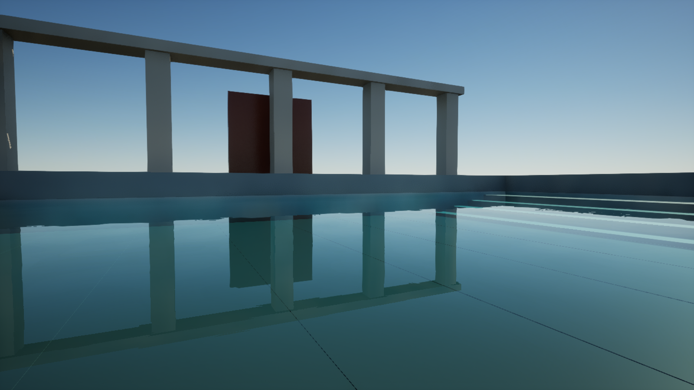

# Pristine Water Physics

**Water simulation and rendering tools for Unreal Engine 5.7.** Build terrain-bounded lakes and pools, interact with buoyant objects, experiment with small-volume liquid, and tune CPU cost with hardware presets and adaptive visual updates.



**Version 0.6.0 · Experimental · Validated on Windows / UE 5.7.4**

Pristine is a foundation for game and animation workflows. It is not yet a production-certified fluid engine or a physically complete reproduction of water. The screenshots are actual Unreal test renders. See [validation and measured performance](Plugins/PristineWaterPhysics/VALIDATION.md) before choosing it for a project.

## What it does

| Tool | Use it for | Model and limits |
| --- | --- | --- |
| Pristine Water Region | Pools, bounded lakes, terrain-following water levels and entry splashes | Conserved shallow-water volume; a single surface height per cell; no overturning waves. |
| Pristine Small Fluid | Small closed containers and liquid experiments | CPU weakly-compressible SPH, up to 1,000 particles, reconstructed surface; experimental. |
| Pristine Water Source | Distant seas, oceans, ponds and inexpensive background water | Analytic waves and geometric ripples; not a volume-conserving ocean solver. |
| Pristine Water Interactor | Buoyancy, drag and entry splashes on physics objects | Sphere approximation; no exact hull displacement or fully coupled momentum exchange. |

Included: editable polygon boundaries, landscape collision baking, water-level tools, ray-visible procedural geometry, original water materials and demo map, Blueprint APIs, temperature-dependent freshwater properties, performance presets and twelve automated regression tests.

## Start here

1. Install **Unreal Engine 5.7** and its Windows C++ development toolchain. The tested engine build is 5.7.4; rebuild for your own engine installation.
2. Clone this repository:
   ```powershell
   git clone https://github.com/Aryan1771/Pristine-Water-Physics.git
   ```
3. Close your Unreal project. Copy `Plugins/PristineWaterPhysics` into `<YourProject>/Plugins/PristineWaterPhysics`. Keep exactly one copy enabled in your project/engine.
4. For a Blueprint-only project, first create an empty C++ class so Unreal generates the project build targets. Generate project files and build **Development Editor / Win64**.
5. Open the project and enable **Pristine Water Physics** in **Edit > Plugins** if needed. Restart when prompted.
6. In the Content Browser settings, enable **Show Plugin Content**. Open `/PristineWaterPhysics/Demo/L_PristineFluidLab` and press **Play**.
7. Follow the [step-by-step tutorials](docs/TUTORIALS.md) to create your own bounded pool, buoyant object and small-fluid setup.

The repository contains source and Unreal assets, not precompiled DLLs. It does not include Unreal Engine. No paid marketplace assets are required; the demos reference Unreal's built-in basic meshes.

## Documentation

- [Unreal installation, rendering and packaging](docs/SETUP.md)
- [Step-by-step tutorials](docs/TUTORIALS.md)
- [Controls, units and Blueprint integration](docs/MANUAL.md)
- [Animation and cinematic workflow](docs/CINEMATICS.md)
- [Detailed solver and rendering notes](Plugins/PristineWaterPhysics/README.md)
- [Validation, limitations and CPU benchmarks](Plugins/PristineWaterPhysics/VALIDATION.md)
- [Troubleshooting](docs/TROUBLESHOOTING.md)
- [Contributing and development checks](CONTRIBUTING.md)
- [Roadmap](docs/ROADMAP.md) and [changelog](CHANGELOG.md)

## How it works

Regions discretize a baked terrain bed into a two-dimensional grid. Water depth and face discharge evolve using a conservative shallow-water approximation with momentum transport, with closed polygon boundaries. Splash droplets temporarily carry volume out of the grid and return it on landing. This conserves modeled volume but does not resolve three-dimensional breaking waves.

Small Fluid uses particle neighbors to evaluate density, pressure, viscosity and approximate cohesion. A compact scalar field and marching tetrahedra turn particles into a renderable liquid surface. Particle mass is conserved; the visual surface volume is approximate. Scene collision is one-way against static geometry.

Source actors evaluate analytic waves. Procedural mesh displacement makes the geometry available to ray intersections. Single Layer Water and translucent materials supply approximate reflection, refraction and absorption. Ray tracing is a rendering option, not a replacement for the fluid solver.

Auto presets use CPU cores, RAM and ray-tracing capability as a starting heuristic. Adaptive visuals measure per-actor CPU solver/mesh time and adjust geometry refresh. They do not measure total GPU time or guarantee the requested FPS. Particle count and region resolution remain unchanged when switching performance presets.

## Development checks

From PowerShell in the repository:

```powershell
./scripts/Test-Repository.ps1
./scripts/Test-Unreal.ps1 -EngineRoot 'C:\Program Files\Epic Games\UE_5.7' -Project 'D:\Projects\WaterTest\WaterTest.uproject' -EditorTarget WaterTestEditor
```

Install this checkout's plugin in the test project first. The Unreal script builds the editor and runs the PristineWater automation suite. It checks both process status and the exported test results. A green test run is not a cooked-game or performance certification.

## License and attribution

Original plugin code and original assets are licensed under [MIT](LICENSE), as authorized by the repository owner. Unreal Engine and referenced engine assets remain governed by Epic's terms and are not relicensed. Scientific property-data references are documented in [THIRD_PARTY_NOTICES.md](THIRD_PARTY_NOTICES.md).


For the new cinematic preset and ray-traced mirror setup, follow [Maximum-quality water](docs/MAXIMUM_QUALITY.md).
