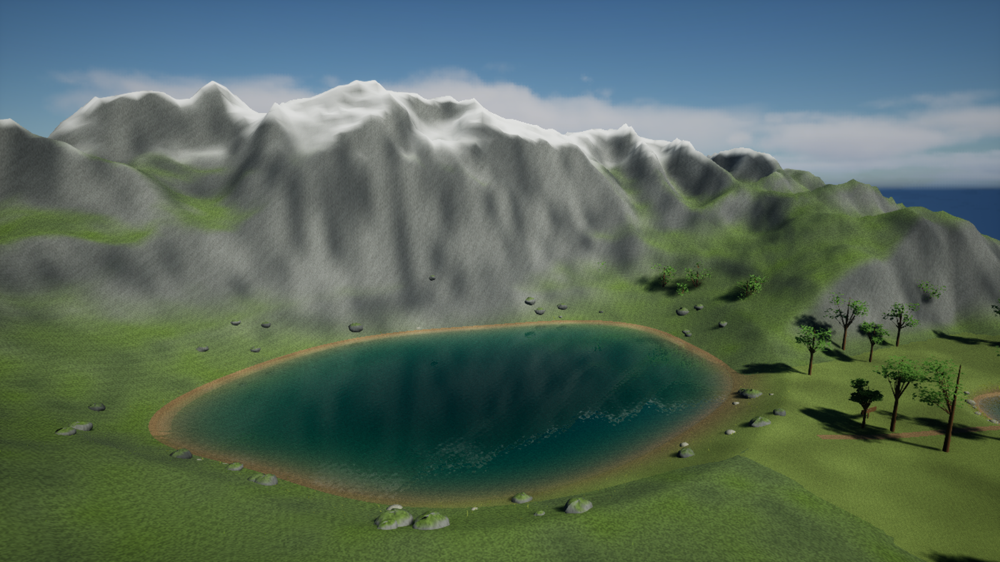

# Alpine lake reference scene

`Tools/CreateAlpineLake.py` extends the four-scale comparison map with a rocky alpine cirque, grassy approaches, scattered shore boulders, high snow patches, volumetric clouds and a reference overview camera. The art direction follows the supplied lake photograph: blue-green depth, clear margins and reflected terrain and sky. All generated geometry and material code are original; the photograph is not bundled or used as a texture.

Captured from the saved comparison map on 15 October 2026 with DX12 and hardware Lumen enabled.

## Build and explore

1. Complete the [nature map setup](NATURE_COMPARISON.md).
2. Complete the [walking and swimming upgrade](SWIMMING_TEST.md).
3. In Unreal, choose **Tools > Execute Python Script** and run `Plugins/PristineWaterPhysics/Tools/CreateAlpineLake.py`.
4. Find **Alpine - reference overview** in the Outliner. Right-click it and choose **Pilot** to inspect the lake composition. Stop piloting to move freely.
5. Press Play. Use **1–4** for the four comparison stations, **5** for the submerged lake position, **V** for the MetaHuman view and **Ctrl / Space** to dive / ascend.

The extension retains the 120 × 84 metre lake, its baked bottom and its approximately 6.5 metre centre depth. The surrounding peaks are a compact scene interpretation, not a geographically accurate reconstruction of the photograph. The smaller basins remain available in the same level, with an approach through the south-west. It uses mesh terrain; it does not convert the project to a sculptable Landscape.

## Adjust the look

- Select the lake Water component. `DeepColor` is transmission at `VolumeDepth` (500 cm), not a painted surface color. Darkening it increases absorption. Keep shallow water clear enough to see the bottom.
- `Roughness` starts at 0.012 and `RippleStrength` at 0.022. Increase them for wind; lower them for a calmer reflected skyline.
- The rock material blends grass and snow using slope, height and spatial noise. Edit `M_AlpineRock` or the generator to change the terrain palette.
- The cloud actor uses Unreal's bundled volumetric cloud material. Its renderer cost is independent of the fluid solver. Reduce cloud quality or disable the actor when profiling water alone.

The extension rebuilds only actors labelled `Alpine - …` when rerun and hides four original background woodland clusters during play. Save custom edits under different labels before regenerating. Back up the map before changing generator parameters. Run the alpine script after the interaction upgrade to restore its lake-specific color settings.

This is a procedural teaching scene. Photographic vegetation, scanned cliffs, production swimming animation and a complete underwater light-transport model are not included.
