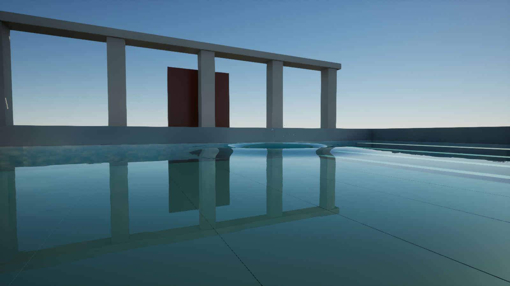

# Maximum-quality water and mirror reflections

Version 0.6 adds **Apply Cinematic Preset** to Region and Source actors. Select the actor and use this button in Details, or call it from Blueprint. It selects M_PristineCinematic, low roughness, almost-clear water, restrained micro-ripples and 60 Hz geometry updates. It leaves Region water volume and simulation resolution intact. Adaptive visuals are disabled for consistent visual refresh, so this mode can be expensive.

## Set up the renderer

Follow the DX12/SM6 and hardware-ray-tracing steps in [SETUP.md](SETUP.md). For maximum-quality reflections on compatible hardware, use these session console settings:

```text
r.Lumen.HardwareRayTracing 1
r.Lumen.HardwareRayTracing.LightingMode 2
r.Lumen.Reflections.DownsampleFactor 1
r.Water.SingleLayer.Reflection.DownsampleFactor 1
r.ScreenPercentage 100
```

LightingMode 2 evaluates reflection lighting at ray hits in UE 5.7. It costs more GPU time than the surface-cache mode. For verification, `r.Lumen.Reflections.ScreenTraces 0` disables reflection screen traces; this avoids mistaking screen-space reflections for hardware ray tracing. It is not necessarily the best performance/quality tradeoff for every shipped scene.

## Create the reflection demo

1. Install the updated plugin and rebuild. Ensure M_PristineCinematic is present; otherwise use Tools > Create Pristine Water Assets.
2. Save your currently open level. Enable Python Editor Script Plugin and Editor Scripting Utilities.
3. Run `Plugins/PristineWaterPhysics/Tools/CreateCinematicDemo.py` through Execute Python Script.
4. The script creates `/Game/PristineCinematicDemo/L_CinematicMirrorWater` from the existing fluid lab, applies the cinematic preset and adds reflection geometry. An existing demo is preserved. It also applies the session settings above.
5. Allow shader compilation and Lumen history to settle, then inspect the water from the low camera angle. Use Play for simulation.
6. Add a splash to compare the reflected scene on calm and disturbed water. Disturbance should bend the reflected geometry, rather than merely adding a bright decal.

## Tune the look

- **Roughness:** start at 0.008 for still water, then increase toward 0.025 for a softer reflection. Region uses Water > Optics > Roughness; Source has its own Appearance > Roughness override. Blueprint SetRoughness updates the component live.
- **Ripple Strength:** 0.005–0.015 gives a restrained calm surface. Use larger values for wind disturbance. A perfectly still mirror uses zero micro-ripples, but physical simulation waves still displace the mesh.
- **Reflectivity:** keep at 1 in this material for water's dielectric reflectance. It is a multiplier, not “100% mirror.” The IOR of 1.333 gives about 2% reflection head-on and much stronger reflection at grazing angles through Unreal's BRDF.
- **Foam:** the calm preset disables shoreline and flow foam. Foam can roughen water and obscure reflections. Enable it for disturbed water using the component's Foam Amount/Shore Foam controls.
- **Absorption/clarity:** retain visible depth cues and submerged geometry. Do not make all water opaque chrome to force a mirror effect.

The cinematic material uses dielectric F0 without applying a second view-angle Fresnel factor or a painted diffuse water color. Absorption/scattering still use Single Layer Water's model. Scene lighting, reflected objects, camera angle, render resolution and temporal history materially affect the result.

This is a high-quality real-time rendering mode, not a full spectral/path-traced water solution. Caustics, arbitrary underwater optics, full fluid sheets and exact ray-traced translucency parity remain outside the validated scope. The solver also remains a shallow-water approximation for large regions and experimental SPH for small fluid.

## Captured comparison

Actual UE 5.7.4 / RTX 4060 Laptop captures at 1600 x 900, with a 128 x 128 region grid. The same camera and material are used for both images. These are scene checks, not a frame-rate benchmark.

Calm surface:


After AddSplash and 0.3 seconds of simulation:


