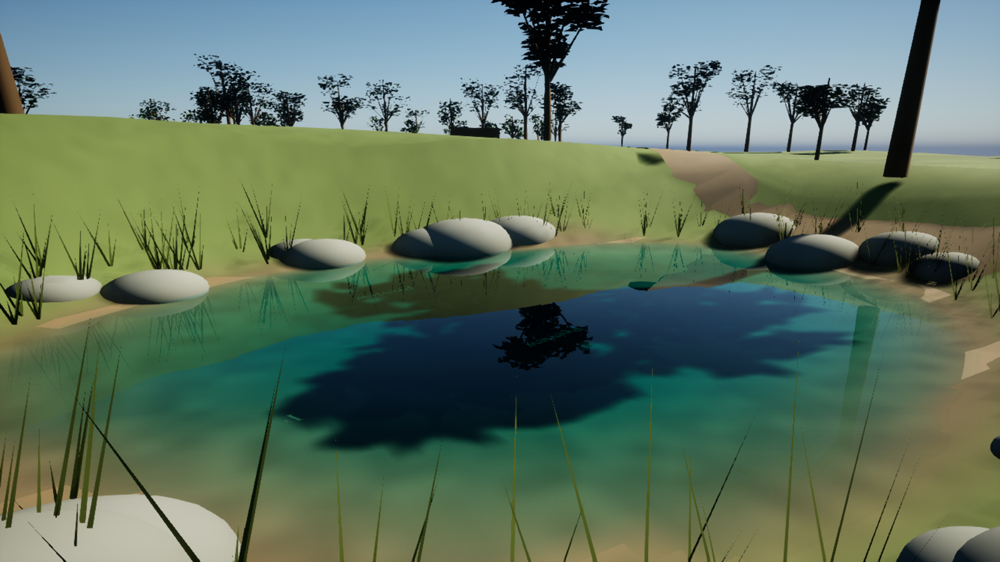
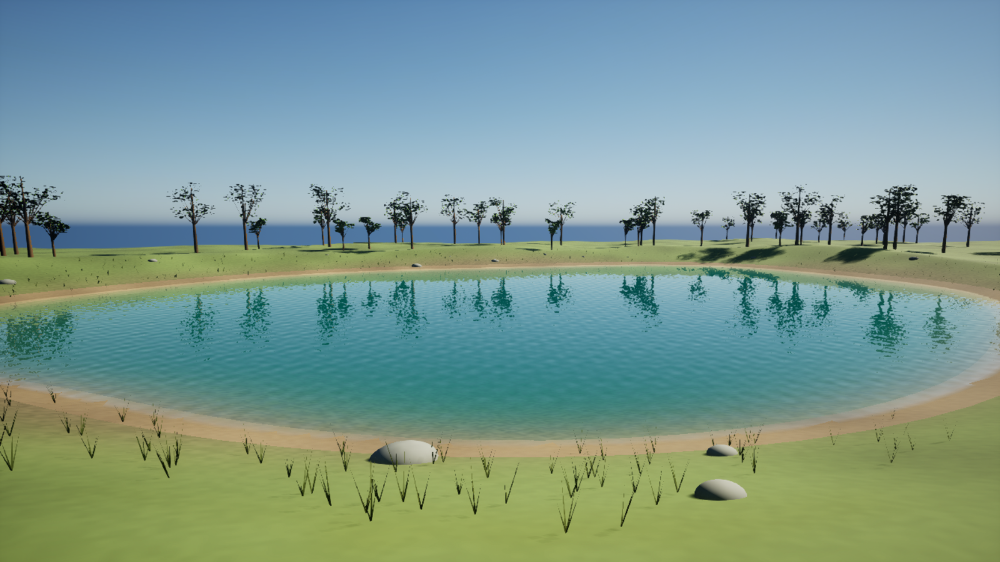

# Puddle to lake: one comparison scene

`/Game/PristineNature/L_WaterComparison` places four water regions in a single 320 x 300 metre woodland terrain. Each region has a distinct basin, water level, simulation grid and camera. Original procedural vegetation, rocks and ground materials require no marketplace downloads.

This is an editable teaching scene, not a claim of photographic vegetation or a production-complete ecosystem. The water uses the plugin's cinematic material and terrain-bounded shallow-water solver. The saved world includes everything needed to compare these water scales.

## Open or regenerate

1. Install this checkout's plugin in a UE **5.7** C++ project and build Development Editor / Win64. See [setup](SETUP.md).
2. Enable **Python Editor Script Plugin**. Restart the editor if prompted.
3. Choose **Tools > Execute Python Script** and select `Plugins/PristineWaterPhysics/Tools/CreateNatureComparison.py`.
4. The generator builds and saves `/Game/PristineNature/L_WaterComparison`. It preserves an existing map. Initial generation and serialization can take several minutes.
5. Open that map in the Content Browser. In the Outliner, expand **Cameras - right click and Pilot**. Right-click a camera and choose **Pilot** to compare its view. Stop piloting before flying to another position.
6. Press **Play** to run the water. With the default game mode, use the default flying pawn. Alternatively use **Simulate**, select a water actor and inspect live solver measurements.

For a separate variation, change `ROOT` near the top of the generator before running it. To change the terrain shapes, edit `BODIES` and the `height()` function in a new variation. The generated terrain is collision-enabled mesh geometry, not a sculptable Unreal Landscape actor. You can replace it with a Landscape and rebake using the same region tools.

## What changes with water size

All distances in actor controls are **centimetres**. The water actors are placed at their surface elevation and use local `Water Level = 0`.

| Stop | Approx. surface footprint | Centre depth | World surface Z | Grid | Approx. cell width X | Normal ripple strength | Roughness |
| --- | --- | --- | --- | --- | --- | --- | --- |
| 01 Puddle | 3 x 1.8 m | 4 cm | 250 cm | 48 x 48 | 7.5 cm | 0.005 | 0.008 |
| 02 Woodland pool | 11 x 7.6 m | 35 cm | 200 cm | 64 x 64 | 20.6 cm | 0.005 | 0.008 |
| 03 Reed pond | 30 x 22 m | 220 cm | 100 cm | 96 x 96 | 37.5 cm | 0.045 | 0.025 |
| 04 Mirror lake | 120 x 84 m | 650 cm | 0 cm | 128 x 128 | 112.5 cm | 0.045 | 0.025 |

Footprints are irregular ellipses. Cell widths are estimates from the boundary extent, which extends onto the dry bank. Depth follows the terrain rather than a uniform box. Shoreline interpolation and collision sampling slightly change actual volumes.

The larger grid does **not** give the lake puddle-scale detail. A one-metre lake cell cannot resolve a centimetre-sized droplet. Use a local high-resolution region for close interactions, a small-fluid container for poured liquid, and analytic distant water when conservation is unnecessary. Normal ripples affect shading; physical surface movement comes from the solver.

## Five comparison exercises

1. **Raise the puddle by 2 cm.** Select `01 Puddle`, change Water Level from 0 to 2, then click **Reset Water**. Watch its coverage expand up the shallow grade. Reset to 0 afterward. This reinitializes water volume; it is an authoring operation, not continuous rainfall.
2. **Change the boundary.** Select the region's Boundary spline and move its polygon points. Keep the outline beyond the visible shore on dry ground. Click **Bake Landscape** after changing the outline, terrain, transform or resolution. The `Terrain Actors` list isolates the correct ground from stones and decoration.
3. **Compare clear and disturbed reflections.** With a low camera, compare Roughness 0.008 versus 0.08 and Ripple Strength 0.005 versus 0.15 on the Water component. Do not set Metallic to 1: water is a dielectric. Restore the table values for the default scene.
4. **Test a splash.** In a Blueprint, reference the selected Pristine Water Region and call `Add Splash(WorldPosition, VelocityCmPerSecond, RadiusCm, Strength)`. Use a position on its surface, downward velocity `(0,0,-300)`, strength 1 and radius at least two cell widths. For a lake, start around 250 cm radius; a 5 cm impulse is below this lake grid's resolution. The regular [fluid lab](TUTORIALS.md) provides smaller-volume and buoyancy examples.
5. **Measure cost.** In Play or Simulate, inspect Performance > Average Solver Ms, Average Mesh Ms, Effective Surface Hz and Unsimulated Seconds. Use `stat unit` and `stat gpu` to distinguish simulation cost from lighting/vegetation cost. Stop simulation before changing resolution and rebaking.

## Hardware and quality

The saved cinematic preset favors reflection quality. For slower PCs, select a water actor, choose Performance Preset **Balanced** or **Low**, and click **Apply Performance Settings**. Enable Adaptive Visuals if you want the surface refresh rate to respond to CPU cost. Settings are per water actor; four separate budgets are not one global budget.

For a lower-cost comparison, use grids **32 / 48 / 64 / 96** from puddle to lake, then rebake each region. Reduce viewport resolution and vegetation/shadow cost separately if the GPU is the bottleneck. Automatic presets are heuristics, not a measured guarantee of 60 FPS. The solver does not silently lower its grid resolution.

For supported hardware, follow [maximum quality](MAXIMUM_QUALITY.md): DX12, SM6, Lumen, hardware ray tracing and procedural-mesh ray visibility. Low-angle cameras show reflection strongest; looking straight down into clear water shows its bed. A mirror-like surface does not require metallic shading. Path tracing is a separate renderer and is not certified by these Lumen captures.

## Upgrade the vegetation later

Start with [European Black Alder](https://www.fab.com/listings/9de7ce19-5813-42d2-a5f0-5e6447006f72) and [Open World Demo Collection](https://www.fab.com/listings/3262ab8f-f64a-4124-8efd-82cb19df6249). Replace the `Vegetation` folder actors with foliage instances or a PCG graph. Keep the `Terrain Actors` whitelist unchanged so canopy and decorative stones do not become the simulation bed. These optional third-party assets are not included or relicensed with this project.

The [free starter kit](FREE_ASSET_STARTER_KIT.md) explains which other samples, models and built-in plugins are worth keeping.

## Validation

The generator was built and executed in UE 5.7.4 on Windows. The saved map was reopened, all four terrain bakes were valid, and each region was advanced through 120 steps of 1/60 second. The measured volumes before and after this calm-water check were unchanged: **0.083947, 10.848042, 567.299764 and 25,759.911606 m³**. Every grid cell had a valid terrain sample. These checks validate persistence and equilibrium conservation; they are not a certification of all real-water phenomena or a GPU performance benchmark.

The source generator is stored in Git so the scene can be recreated without putting a large generated `.umap` in the plugin repository. The provided local project archive contains the generated map and materials, source and plugin content, without engine binaries or marketplace assets.
