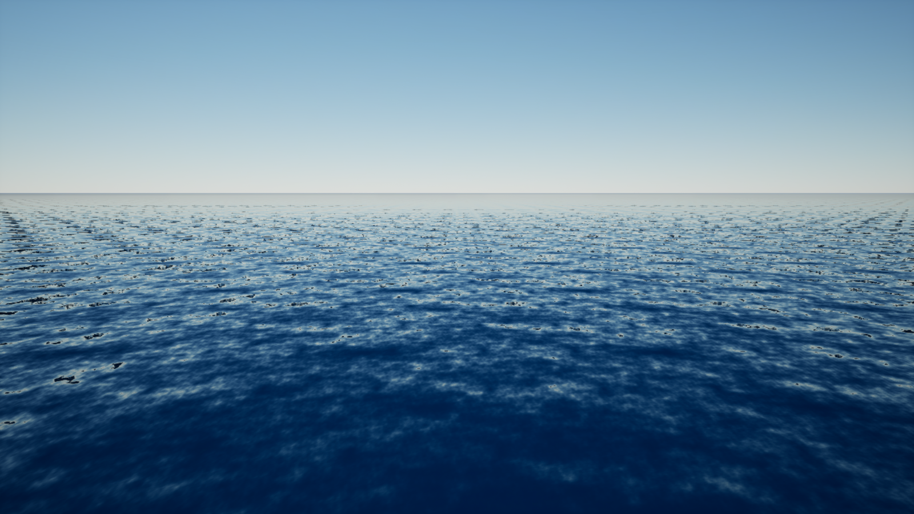
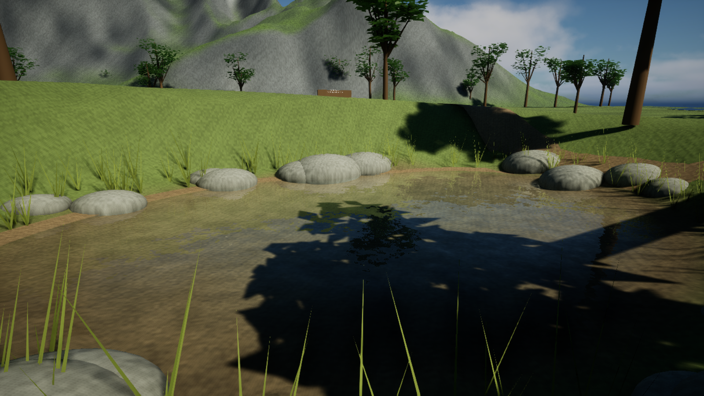

# Surface detail and photographic reference workflow

Use the ocean photograph to judge wave scale, horizon softness and reflected sky. Water color depends on the sky, viewing angle, depth and what lies underneath. A shallow puddle should reveal its bed; a deep ocean should not share the puddle's color or ripple size.

Actual DX12 captures from the local UE 5.7.4 project. These show the current look; the water and procedural surroundings are still under development.

## Update an existing project

1. Build Development Editor with this plugin source.
2. Regenerate bundled materials with the `PristineWaterAssets` commandlet. Back up customized plugin master materials first: the commandlet rebuilds them. Custom material instances can remain separate.
3. Open the nature comparison map, then run `Tools/UpgradeSurfaceDetail.py` through **Tools > Execute Python Script**. It updates appearance without resetting the water volume or rebuilding the terrain. Run it after the alpine extension, which has its own look preset.
4. Run `Tools/CreateOceanReference.py` to create `/Game/PristineNature/L_OceanReference` in the same project. The existing puddle, pool, pond and lake stay in `/Game/PristineNature/L_WaterComparison`. Existing ocean reference maps are loaded rather than overwritten.
5. Compare both maps in DX12 with hardware Lumen reflections enabled. Give the sky capture and temporal rendering time to settle before judging a still frame.

## Scale controls

| Body | Detail scale (cm) | Ripple strength | Roughness |
|---|---:|---:|---:|
| Puddle | 90 | 0.035 | 0.012 |
| Pool | 180 | 0.07 | 0.018 |
| Pond | 400 | 0.15 | 0.025 |
| Lake | 900 | 0.25 | 0.025 |
| Ocean reference | 1200 | 0.30 | 0.07 |

For a **Region**, edit **Water > Motion > Surface Detail Scale Cm** and **Ripple Strength**, then Apply Water Settings. For a **Source**, its **Normal Tiling** setting controls detail scale. This is the repeat length of the broad normal texture; its spectrum contains several wavelengths, and two additional sampled layers add finer detail. It is independent of the simulated wave wavelength and basin depth.

Adjust roughness together with ripple strength. Small roughness with strong normals creates glitter; increasing roughness broadens reflected highlights. Mirror-like still water needs a calm surface and a detailed reflected environment. Retain dielectric reflectivity and change the water's absorption rather than painting the surface blue. The Single Layer Water materials now reserve diffuse base color for foam; transmission and scattering supply the liquid's color.

## Rendering and cost

The normal tile contains a deterministic directional wave spectrum, with rotated moving layers to reduce visible repetition. Texture mipmaps filter distant detail. A derivative-based roughness adjustment reduces aliasing from normal variation; it is an approximation and does not recover every subpixel wave's energy. The lowest material uses one normal sample; the other materials use three. The new layer adds a texture sample rather than increasing the fluid grid or particle count.

Ocean geometry fades displacement and its shading slopes together when a wavelength has fewer than four to eight mesh samples. The outer stretched grid consequently approaches a smooth horizon. Gameplay height queries still evaluate the analytic waves; the filtered distant mesh is intended for viewing, not exact collision at the ocean perimeter.

Profile on the target PC. Solver resolution, update rates, geometry, ray tracing, clouds and screen resolution have separate costs. These look controls do not promise a particular frame rate or turn the analytic Source ocean into a full three-dimensional fluid solver.

Small liquid and droplets retain their volume surfaces and separate material path; applying ocean-scale normals to droplets would give the wrong scale. The procedural terrain and vegetation remain a demonstration environment. Photographic scene quality also requires detailed surroundings, suitable lighting, animation and camera work.
